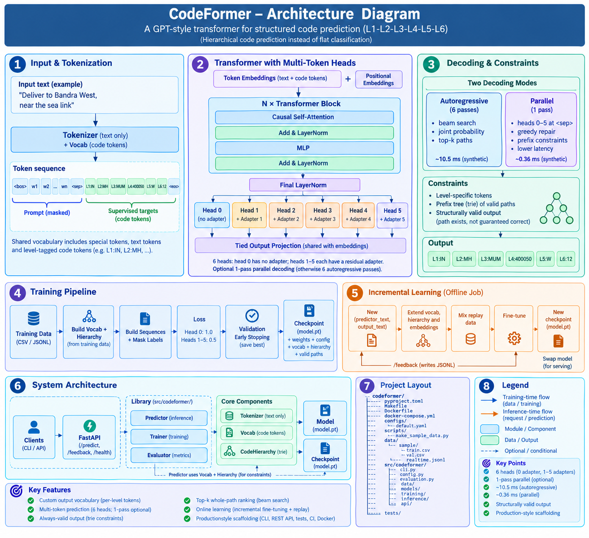

# codeformer

A GPT-style (decoder-only) transformer that reads **text** and predicts a **structured
sequence of custom tokens** — e.g. a six-level hierarchial code `L1-L2-L3-L4-L5-L6` — instead of
one word at a time.

```
"Deliver to Bandra West, near the sea link"  ──►  IN-MH-MUM-400050-W-12
```

* **Custom output vocabulary** – each level has its own token namespace (`L1:IN`, `L2:MH`, …).
* **Multi-token prediction** – auxiliary heads predict *t+1 … t+k*, so all six levels can come out of **one forward pass**.
* **Always-valid output** – decoding is constrained by level and by a prefix tree (trie) of known paths, so `L3` is always a real child of the predicted `(L1, L2)`.
* **Top-k whole-path ranking** – beam search with joint probabilities.
* **Online learning** – incremental fine-tuning on fresh `(predictor_text, output_text)` pairs, including *brand-new codes* (embedding matrix grows in place) with replay to limit forgetting.
* **Production plumbing** – typed config, CLI, REST API, tests (98 % coverage), CI, Docker.

---

## Contents
1. [How it works](#how-it-works)
2. [Project layout](#project-layout)
3. [Quick start](#quick-start)
4. [Data formats](#data-formats)
5. [Training](#training)
6. [Inference](#inference)
7. [Realtime / incremental training](#realtime--incremental-training)
8. [REST API](#rest-api)
9. [Configuration reference](#configuration-reference)
10. [Testing](#testing)
11. [CI/CD](#cicd)
12. [Docker](#docker)
13. [Results on the bundled synthetic data](#results-on-the-bundled-synthetic-data)
14. [Adapting to your real data](#adapting-to-your-real-data)
15. [Design notes and limitations](#design-notes-and-limitations)

---

## How it works

### Sequence layout

Every training example becomes one sequence. Only the right-hand side is supervised:

```
<bos> w1 w2 ... wn <sep>  L1:IN L2:MH L3:MUM L4:400050 L5:W L6:12  <eos>
└──── prompt (masked) ───┘ └────────── supervised targets ────────┘
```

The shared vocabulary holds specials (`<pad> <unk> <bos> <sep> <eos>`), text tokens and
**level-tagged code tokens**. Tagging means code `"01"` at level 2 and `"01"` at level 5 are
different tokens, which is what makes per-level masking possible.

### Multi-token prediction heads

```
 tokens ──► embeddings ──► N × [causal self-attention + MLP] ──► hidden h_t
                                                                    │
            head 0:  h_t              ──► tied output proj ──► token t+1
            head 1:  h_t + adapter_1  ──► tied output proj ──► token t+2
            ...
            head 5:  h_t + adapter_5  ──► tied output proj ──► token t+6
```

Head *j* at position *t* is trained against the label at *t+1+j*. The loss is the weighted
mean over heads (`aux_loss_weight` for heads ≥ 1). At the `<sep>` position the six heads
predict `L1 … L6` simultaneously.

### Two decoding modes

| mode | passes | what it does | use when |
|---|---|---|---|
| `autoregressive` | 6 | head 0 only, beam search over complete paths, joint-probability ranking, returns top-k | you need alternatives / best accuracy |
| `parallel` | **1** | heads 0-5 at `<sep>`, then greedy prefix-constrained repair | latency / throughput matters |

In both, each step is restricted to tokens of the right level and (by default) to children
of the already-chosen prefix in the `CodeHierarchy` trie. Disable with `use_hierarchy=False`.

---

## Project layout

```
codeformer/
├── pyproject.toml            # packaging, deps, ruff/pytest config
├── Makefile                  # install / lint / test / train / serve / docker
├── Dockerfile                # multi-stage, non-root, healthcheck
├── docker-compose.yml
├── configs/default.yaml      # all hyper-parameters
├── scripts/make_sample_data.py
├── data/sample/              # generated demo data (train.csv, val.csv, realtime.jsonl)
├── src/codeformer/
│   ├── config.py             # typed dataclass config + YAML loader (rejects unknown keys)
│   ├── cli.py                # train | finetune | predict | evaluate | serve
│   ├── evaluation.py         # per-level / exact / top-k / valid-path metrics
│   ├── data/
│   │   ├── codes.py          # CodeSpec, parse_codes, CodeHierarchy (trie)
│   │   ├── vocab.py          # unified vocab, level-tagged code tokens
│   │   ├── tokenizer.py      # swappable text tokenizer
│   │   ├── io.py             # CSV/JSONL readers, column aliases, writers
│   │   ├── dataset.py        # sequence building, label masking, collate
│   │   └── synthetic.py      # hierarchical synthetic data (tests/demos)
│   ├── models/transformer.py # GPT blocks + multi-token heads + resize_vocab
│   ├── training/
│   │   ├── trainer.py        # AdamW, warmup+cosine, clipping, early stop, AMP
│   │   ├── pipeline.py       # train_model(), incremental_update()
│   │   └── checkpoint.py     # atomic single-file checkpoints (weights_only-safe)
│   ├── inference/predictor.py# constrained beam search + parallel decoding
│   └── api/                  # FastAPI app + pydantic schemas
├── tests/                    # 73 tests
└── .github/workflows/        # ci.yml, release.yml (+ dependabot.yml)
```

---

## Quick start

```bash
python -m venv .venv && source .venv/bin/activate
pip install -e ".[dev]"            # add: torch --index-url https://download.pytorch.org/whl/cpu  for CPU-only

make sample-data                   # synthetic train/val/realtime files
make train                         # -> artifacts/model.pt  (≈2.5 min on 1 CPU core)

codeformer predict  --checkpoint artifacts/model.pt \
    --text "ship l2k02 to l3k03 package l4k02 l5k01 l6k02" --top-k 3
# 01-02-03-02-01-02   0.7386
# 02-02-03-02-01-02   0.1587
# 03-02-03-02-01-01   0.0840

codeformer evaluate --checkpoint artifacts/model.pt --data data/sample/val.csv --mode parallel
make serve                         # http://localhost:8000/docs
```

---

## Data formats

CSV or JSONL. Column names are matched by alias, so **training data** and **realtime data**
can use different schemas without code changes:

| meaning | accepted columns (first match wins) |
|---|---|
| input text | `text`, `predictor_text`, `input` |
| output codes | `codes`, `output_text`, `target`, `code` |

Codes may be a delimited string (`IN-MH-MUM-400050-W-12`, delimiter configurable) or, in
JSONL, a list (`["IN","MH","MUM","400050","W","12"]`).

```csv
text,codes
"Deliver to Bandra West near sea link",IN-MH-MUM-400050-W-12
```
```jsonl
{"predictor_text": "parcel for Whitefield Bengaluru", "output_text": "IN-KA-BLR-560066-E-03"}
```

Rows with the wrong number of levels, empty levels or empty text are **skipped and counted**
(use `strict=True` in `load_examples` to raise instead). Codes may contain anything except the
delimiter, so pick a delimiter that never appears inside a code.

---

## Training

```bash
codeformer train --config configs/default.yaml \
    --train data/train.csv --val data/val.csv --out artifacts/model.pt [--device cuda] [-v]
```

* No `--val`? 10 % of train is held out (`--val-split`).
* The vocabulary and hierarchy are built **from the training file only**; validation rows
  containing codes unseen in training are dropped (they cannot be scored) with a warning.
* `artifacts/model.pt` always holds the **best-validation** checkpoint (written atomically).
* Training uses AdamW (no decay on norms/biases), linear warmup + cosine decay, gradient
  clipping, optional CUDA mixed precision, early stopping.

A checkpoint is one file: weights, model/data config, vocab, and every known code path.

---

## Inference

```python
from codeformer.inference import Predictor

p = Predictor.from_checkpoint("artifacts/model.pt", device="cpu")

# top-3 complete paths with joint probabilities
for pred in p.predict("parcel for Whitefield", top_k=3)[0]:
    print(pred.as_string(p.spec), pred.score, pred.level_probs)

# single forward pass, batched
p.predict(["text a", "text b"], mode="parallel")
```

`Prediction` = `codes` (tuple), `score` (joint probability over the *allowed* set at each
step) and `level_probs` (per-level confidence — handy for thresholds like “auto-accept only
if every level ≥ 0.9, otherwise route to a human”).

---

## Realtime / incremental training

Stream `(predictor_text, output_text)` pairs to a JSONL file (the API's `/feedback`
endpoint does exactly this), then run periodically:

```bash
codeformer finetune \
    --checkpoint artifacts/model.pt \
    --data artifacts/feedback.jsonl \
    --replay data/train.csv --replay-ratio 1.0 \
    --epochs 3 --lr 1e-4 \
    --out artifacts/model_v2.pt
```

What happens:

1. New text tokens, new codes and new paths are added to the vocab/hierarchy. Existing ids
   never change; the tied embedding matrix is **grown in place**, old rows copied.
2. `--replay` mixes a random sample of old data (`replay_ratio × len(new)`) with the new
   pairs to limit catastrophic forgetting.
3. A new checkpoint is written; the source checkpoint is never modified.
4. Roll out by swapping the file mounted at `/models/model.pt` and restarting the container.

Tips: use a lower LR than initial training; keep a held-out set and run
`codeformer evaluate` on the new checkpoint before promoting it; for large volumes of new
codes consider a full retrain.

---

## REST API

Run `make serve` or the Docker image. Interactive docs at `/docs`.

| endpoint | purpose |
|---|---|
| `GET /health` | `status: ok` + model stats, or `degraded` if no model is loaded |
| `POST /predict` | `{"texts": [...], "top_k": 3, "mode": "autoregressive"\|"parallel", "use_hierarchy": true}` |
| `POST /feedback` | `{"predictor_text": "...", "output_text": "A-B-C-D-E-F"}` → appended to the feedback JSONL (202) |

```bash
curl -s localhost:8000/predict -H 'content-type: application/json' \
  -d '{"texts":["parcel for Whitefield"],"top_k":2}'
```

Environment: `CODEFORMER_CHECKPOINT`, `CODEFORMER_DEVICE`, `CODEFORMER_FEEDBACK`.
**There is no authentication** — put it behind your gateway/ingress before exposing it.

---

## Configuration reference

`configs/default.yaml` (every key optional; unknown keys are an error).

| section | key | default | meaning |
|---|---|---|---|
| data | `n_levels` | 6 | number of code levels |
| data | `delimiter` | `-` | separator in code strings |
| data | `min_freq` | 1 | min frequency for a text token to enter the vocab |
| data | `lowercase` | true | lowercase text before tokenising |
| model | `n_layers`, `n_heads`, `d_model`, `d_ff` | 4, 4, 128, 512 | transformer size |
| model | `max_seq_len` | 64 | `bos + text + sep + n_levels + eos` must fit; text is truncated |
| model | `dropout` | 0.1 | |
| model | `n_future` | 6 | prediction heads; **≥ n_levels enables `parallel` mode** |
| model | `aux_loss_weight` | 0.5 | weight of heads 1..n_future-1 |
| train | `epochs`, `batch_size`, `lr` | 15, 64, 5e-4 | |
| train | `weight_decay`, `warmup_ratio`, `grad_clip` | 0.01, 0.05, 1.0 | |
| train | `early_stopping_patience` | 4 | 0 disables |
| train | `mixed_precision` | false | CUDA only |

---

## Testing

```bash
make test        # pytest + coverage (73 tests, ~30 s on CPU, 98 % line coverage)
make lint        # ruff
```

| file | what it proves |
|---|---|
| `test_codes_vocab_tokenizer.py` | parsing/validation, trie, level-tagged vocab, id stability |
| `test_data_io_dataset.py` | column aliases (`predictor_text`/`output_text`), bad rows, label masking, truncation, collate |
| `test_model.py` | shapes, **causality**, **padding invariance (left & right)**, multi-token loss alignment, `resize_vocab` exactness |
| `test_training_predictor.py` | loss falls, checkpoint round-trip, **model really learns (both modes ≫ chance)**, 100 % valid paths even on garbage input, beam ordering, batch ≡ single, overfit sanity |
| `test_incremental.py` | new codes become predictable, old ids unchanged, replay retains skill, source checkpoint untouched |
| `test_api.py` | health, predict, validation (422), feedback persistence, 503 without a model |
| `test_cli.py` | `train → predict → finetune → evaluate` end-to-end |

A tiny model is trained once per session in `conftest.py` and reused.

---

## CI/CD

`.github/workflows/ci.yml` (push to `main`, every PR):

1. **lint** – `ruff check` + `ruff format --check`
2. **test** – Python 3.10/3.11/3.12 matrix, CPU torch, coverage gate `--cov-fail-under=85`
3. **smoke-e2e** – CLI train → evaluate → predict → finetune on generated data
4. **docker** – builds the image and checks `/health` of a model-less container

`.github/workflows/release.yml` – on tags `vX.Y.Z`, builds and pushes
`ghcr.io/<owner>/<repo>:{X.Y.Z, X.Y, sha}` using the built-in `GITHUB_TOKEN`
(no secrets to configure). `dependabot.yml` keeps pip/Actions/Docker pinned versions fresh.

Release flow: `git tag v0.1.0 && git push --tags`.

---

## Docker

```bash
docker build -t codeformer .
docker run --rm -p 8000:8000 \
  -v $PWD/artifacts:/models:ro -v cf_data:/data codeformer
# or
docker compose up --build
```

Multi-stage build, CPU-only torch, runs as a non-root user (uid 10001), `HEALTHCHECK` on
`/health`. The model is **not baked in**: mount it at `/models/model.pt` so you can ship
new models without rebuilding. For GPU serving, use a CUDA base image, install the CUDA
torch wheel and set `CODEFORMER_DEVICE=cuda`.

---

## Results on the bundled synthetic data

Default config (≈0.5 M parameters), 4 000 train / 400 val synthetic rows, 15 epochs, 1 CPU core:

| metric | autoregressive | parallel |
|---|---|---|
| per-level accuracy | 92 – 97 % | 92 – 97 % |
| exact 6-level path | 78.8 % | 80.0 % |
| top-3 path | 100 % | – |
| valid-path rate | 100 % | 100 % |
| latency / text (batched, CPU) | ≈10.5 ms | ≈0.36 ms |

Read these carefully: the generator *deliberately hides one level's keyword* in some texts,
so some paths are genuinely ambiguous and exact-match is capped well below 100 %. The numbers
show the machinery works (≫ 0.5 % chance, constraints hold, parallel mode is ~29× faster) —
**they say nothing about your real data**, which you must evaluate yourself.

---

## Adapting to your real data

1. **Tokenizer** – `SimpleTokenizer` is a word-level regex tokenizer with an unknown-word
   fallback. For messy real text (typos, transliteration, addresses) swap in a subword
   tokenizer: implement `tokenize(text) -> list[str]` and pass it to `CodeDataset`/`Predictor`.
2. **Scale** – raise `d_model`/`n_layers`, use `--device cuda` and `mixed_precision: true`.
   Code-vocab size scales with the number of distinct codes per level; the output softmax
   is over the full vocab, so very large leaf levels (100k+ codes) deserve a factorised head.
3. **Pretrained encoders** – if you have little data, initialise embeddings/trunk from a
   pretrained model; the sequence format and heads here don't change.
4. **Variable-depth codes** – pad shallow codes with a sentinel (e.g. `-`) so every row has
   `n_levels` entries.
5. **Hierarchy source of truth** – the trie is built from training data. If you own an
   authoritative code master, load it into the `CodeHierarchy` so valid-but-unseen
   combinations are reachable (the model still needs training signal to prefer them).

---

## Design notes and limitations

* **Why constrain decoding?** An unconstrained model can emit a code that doesn't exist or
  doesn't belong under its parent. Level masks + trie guarantee structural validity; they do
  *not* guarantee the path is the *right* one.
* **Parallel mode caveat** – levels are predicted from one hidden state without seeing each
  other; consistency is restored greedily by the trie, which can favour L1 over deeper
  levels. Use `autoregressive` when joint consistency matters or you need top-k.
* **Unseen codes** – a code absent from training cannot be predicted until you
  `finetune` with examples containing it.
* **No KV-cache** – only six decode steps, so each step re-runs the (short) sequence.
  Add a cache if you extend to long outputs.
* **Feedback endpoint** – appends under a process-local lock; with several replicas use a
  shared queue/DB instead of a local file. Validate/curate feedback before training on it.
* **Checkpoints** are saved with plain tensors/lists and loaded with `weights_only=True`.
* Not included: experiment tracking, distributed training, authentication, model registry.

## License
MIT
